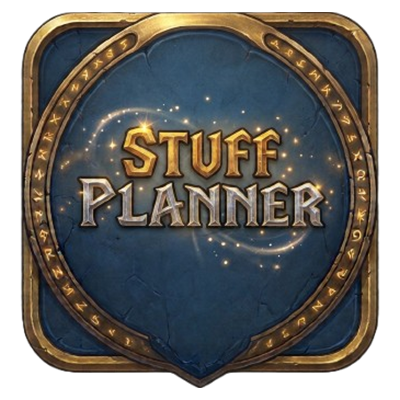

<p align="center">
  
</p>

<h1 align="center">Stuff Planner</h1>

<p align="center">
  <strong>Which quest, dungeon or craft is worth it for your gear?</strong><br>
  A World of Warcraft addon that ranks every reward it knows by the upgrade it brings to <em>your</em> character.
</p>

<p align="center">
  <a href="https://github.com/lokshun/stuff-planner/actions/workflows/ci.yml"></a>
  <a href="https://github.com/lokshun/stuff-planner/releases"></a>
  <a href="https://www.curseforge.com/wow/addons/stuff-planner"></a>
  <a href="LICENSE"></a>
</p>

---

## Why

Leveling and gearing in Classic-style WoW means constantly asking *"is this quest chain worth it?"*
or *"should I run this dungeon again?"*. Stuff Planner answers with numbers: it reads your
equipped items, scores every known reward with stat weights for your specialization, and shows
how much each one would improve you — then plans a route that balances that gain against the
effort it costs.

## Features

| | |
|---|---|
| **Zone tab** | Quests of the current zone, sorted by gear gain, with their source and a confidence level. |
| **Route tab** | A plan for your next steps: quest chains, dungeons, raids and crafts, weighted by effort, XP and how long the item will last. |
| **Gear tab** | The best upgrade for each slot, where to get it and how much it helps. |
| **Profile tab** | Your stat weights, a stat priority editor, import/export of custom weights (`SPW1` strings). |
| **Tooltips** | Gain line on item tooltips; quest givers highlighted in the quest window. |
| **Navigation** | Built-in 3D waypoint arrow, world map and minimap pins. Uses TomTom when installed. |
| **Mini tracker** | The 3 best rewards nearby, always on screen. |
| **Stat weights** | 27 specializations, each with a leveling and a level 60 profile (several imported from WoWSims). |

Also:

- **Works on its own** — ships its own database; uses [QuestieDB](https://github.com/Questie/QuestieDB) when installed for richer quest data.
- **Combat-safe** — nothing is computed during combat; burst events are batched.
- **Lightweight** — the database is a load-on-demand addon, decoded zone by zone.
- **Localized** — English and French; other client languages fall back to English.

## Supported clients

| Client | Version | Notes |
|---|---|---|
| WoW Forever | 1.60.1 (`Interface: 16001`) | Main target. |
| WoW Classic Era | 1.15.x | Forever-only content is hidden automatically. |

## Installation

**CurseForge (recommended):** install [Stuff Planner from CurseForge](https://www.curseforge.com/wow/addons/stuff-planner) or search for *Stuff Planner* in the CurseForge app — updates are automatic.

**Manual:** download the latest `StuffPlanner-x.y.z.zip` from the
[Releases](https://github.com/lokshun/stuff-planner/releases) page and extract it into your
`Interface/AddOns` folder. You must end up with **two** folders:

```
Interface/AddOns/
├── StuffPlanner/        the addon
└── StuffPlanner_Data/   its database (loaded on demand)
```

Optional companions: [QuestieDB](https://github.com/Questie/QuestieDB), [TomTom](https://www.curseforge.com/wow/addons/tomtom).

## Getting started

1. Log in: a 3-step welcome guide lets you pick the weight profile that matches your specialization.
2. Open the main window with `/splan` (or the minimap button).
3. Follow the **Zone** tab while questing, or the **Route** tab to plan ahead.

## Commands

| Command | Action |
|---|---|
| `/splan` | Open or close the main window |
| `/splan best` | List the 5 best quest rewards of the current zone in chat |
| `/splan tracker` | Show or hide the mini tracker |
| `/splan arrow` | Turn the waypoint arrow on or off (used without TomTom) |
| `/splan pins` | Show or hide map pins |
| `/splan options` | Open the settings panel |
| `/splan scale 0.9` | Set the window scale |
| `/splan welcome` | Show the welcome guide again |
| `/splan export` | Export collected observations as text to share |
| `/splan perf` | Show memory use and the last computation times |
| `/splan help` | Show all commands |

## How it works

```
Score(item) = Σ weight(stat) × value(stat)
Gain        = Score(new) − Score(equipped)          shown as a percentage
Priority    = (Gain × item lifetime + α · XP) / effort
```

- Hit caps are handled at the margin: hit above the cap is worth nothing.
- Effort depends on the source: remaining quest chain, elite mobs, distance; drop rate for
  dungeons; raids are heavily weighted and off the route by default; skill and reagents for crafts.
- The weight profile switches from *leveling* to *level 60* automatically.

Data comes in three layers, the most specific winning:

1. **Imported database** — built offline from public sources, each entry with a confidence level.
2. **Overlay** — corrections merged from player exports (`/splan export`).
3. **Local observations** — what the addon saw on your client (rewards, NPC positions, item stats).

## Known limitations

- No world drops or vendor sources yet.
- Some item stats are estimated on Classic Era and flagged *unconfirmed* until seen in game.
- Hidden Forever items are only known once the server reveals them.

## Contributing

Bug reports, data exports and pull requests are welcome — please open an
[issue](https://github.com/lokshun/stuff-planner/issues). For wrong or missing data, attaching the
output of `/splan export` helps a lot.

### Building from source

Requirements: GNU Make, a POSIX shell (Git Bash on Windows), Lua 5.1 with
[luacheck](https://github.com/lunarmodules/luacheck), Python 3.

| Command | What it does |
|---|---|
| `make lint` | luacheck + check that version-specific APIs go through `Compat` |
| `make data` | Build `StuffPlanner_Data` from the sources (downloaded and cached in `tools/cache/`) |
| `make weights` | Regenerate `Profiles/Defaults.lua` from `tools/weights_input/` |
| `make zip` | Fetch pinned libraries and package `build/StuffPlanner-<version>.zip` |
| `make deploy` | Copy the addon to your AddOns folders (`WOW_ADDONS_VANILLA` and `WOW_ADDONS_FOREVER` in a `.env` file) |

### Project layout

```
StuffPlanner/        main addon
  Core.lua           namespace, message bus, slash commands
  Compat*.lua        every API that differs between Forever and Classic Era
  Data/              database access, QuestieDB adapter, observation collector
  Engine/            pure Lua (no WoW API): stat parsing, scoring, route planning
  UI/  UI/Presenters/  frames, and the testable logic behind them
  Profiles/          stat weights and priorities
  Locales/           AceLocale strings
tools/               Python database builder, packager, weight generator
```

Each Lua module starts with a short `CONTRAT` header describing its interface.

## Credits

The database is built from:

- [QuestieDB](https://github.com/Questie/QuestieDB) — quests, rewards, maps (GPLv3)
- [NorgannonDB](https://github.com/zmarotrix/NorgannonDB) by Maro — Classic instance boss loot (GPLv3)
- [pfQuest](https://github.com/shagu/pfQuest) by Shagu — drop rates, via NorgannonDB (MIT)
- [WoW-Spyglass](https://github.com/Karl-HeinzSchneider/WoW-Spyglass) — encounter loot and Forever item stats (MIT)
- [wago.tools](https://wago.tools) — game client tables
- [WoWSims](https://github.com/wowsims) — stat weights for several specializations

Libraries: Ace3, LibDataBroker-1.1, LibDBIcon-1.0, HereBeDragons-2.0, LibDeflate.
Full third-party notices: [`tools/THIRD_PARTY.txt`](tools/THIRD_PARTY.txt).

World of Warcraft and its game data are trademarks and property of Blizzard Entertainment, Inc.
This project is not affiliated with or endorsed by Blizzard.

## License

[GNU General Public License v3.0](LICENSE).
